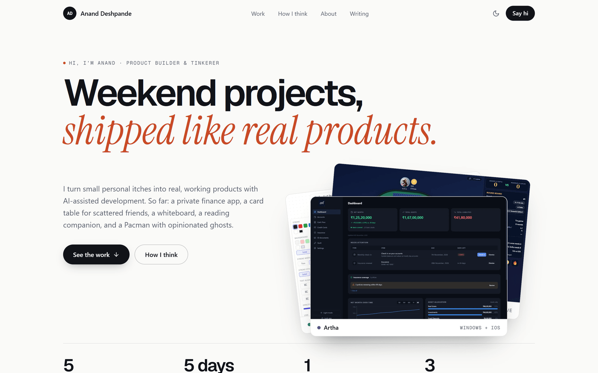
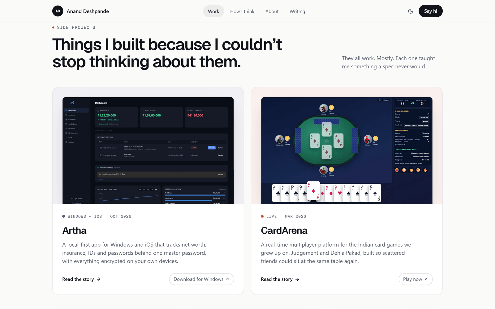
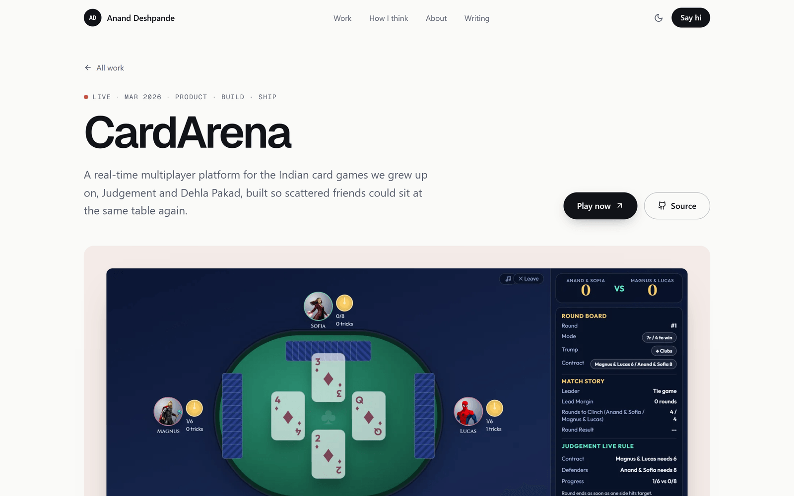
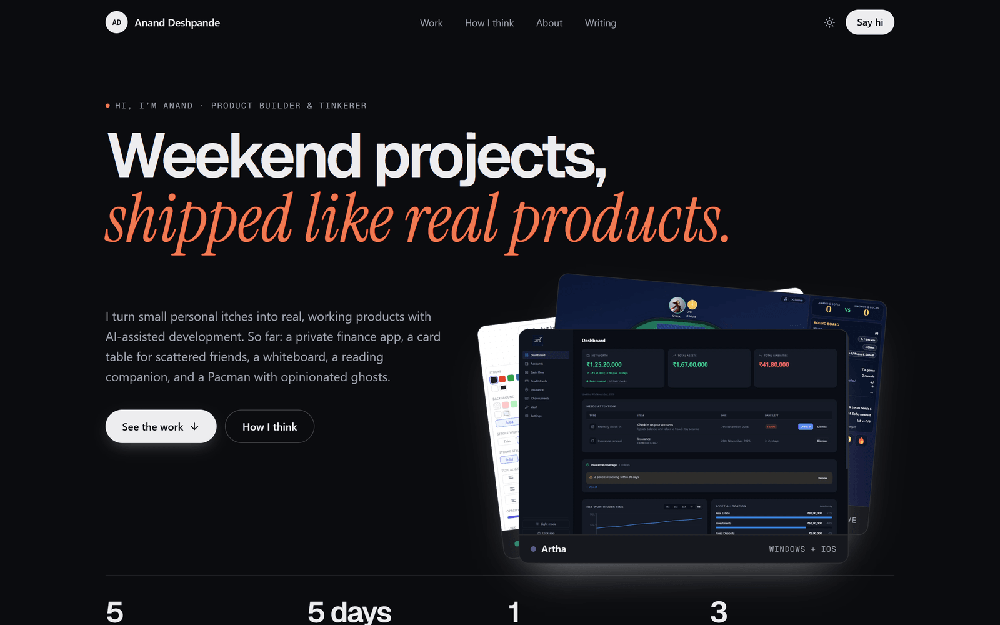

# Anand Deshpande · Portfolio

Personal site for a product builder and tinkerer: side projects you can actually click, and the thinking behind them.

**Live:** [ananddeshpande.in](https://ananddeshpande.in)



| Side projects | Project page |
| --- | --- |
|  |  |



## Stack

Next.js 16 (App Router, fully static export) · TypeScript · Tailwind CSS · Markdown content · self-hosted Geist + Instrument Serif · hosted on Azure Static Web Apps.

No client-side animation library: reveals use CSS scroll-driven animations, so every page is fully readable without JavaScript.

## Quick start

```bash
npm install
npm run dev          # http://localhost:3000
npm run build        # static export -> ./out
npm run typecheck
```

## Editing content

Everything is data-driven, so you rarely need to touch component code.

| I want to change… | Edit this |
| --- | --- |
| Name, hero copy, links, contact copy | [`src/lib/site.ts`](src/lib/site.ts) → `site` |
| Principles, About, section headings, nav | [`src/lib/site.ts`](src/lib/site.ts) |
| Add / edit a **project** | A `.md` file in [`content/projects/`](content/projects) (copy `_TEMPLATE.md`) |
| Project screenshots | `public/projects/<slug>/` (1600×1000 WebP) |
| Add / edit a **blog post** | A `.md` file in [`content/blog/`](content/blog) |
| Colors / theme | CSS variables at the top of [`src/app/globals.css`](src/app/globals.css) |
| Social preview images | `public/og/*.png` (1200×630) |

See [`AGENTS.md`](AGENTS.md) for the full content model, design system, and conventions.

## Deploy

Pushing to `main` deploys via [`.github/workflows/azure-static-web-apps.yml`](.github/workflows/azure-static-web-apps.yml). Security headers, caching, and the 404 page are configured in [`staticwebapp.config.json`](staticwebapp.config.json).
